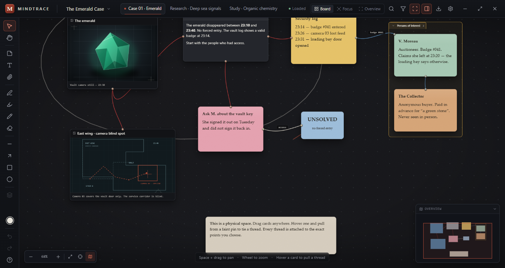

# Mindtrace

**A tactile investigation board for Windows.** An infinite canvas where images, notes, documents, video and chalk drawings can be pinned anywhere and connected with physical-looking threads. Nothing is snapped to a template. Nothing moves unless you move it.

Mindtrace is built for investigations, research, study, project planning, code architecture, creative work and personal knowledge — one board at a time.



## What it does

- **Infinite canvas** — free pan, cursor-centred zoom, marquee selection, multi-card drag, snapping (optional), minimap, fit-to-board and a camera that is saved per space.
- **Materials** — rich text cards, sticky notes, images, video, audio, PDF, DOCX/DOC, TXT/Markdown, generic files and web links. Images open in a lightbox; documents have in-card previews.
- **Pins & threads** — eight implicit anchors per card plus unlimited custom pins. Pins stay hidden until a card is hovered, selected, or actually connected. Threads are cubic curves pinned to exact points, with colour, width, style, labels and per-thread hiding.
- **Readability first** — cards always paint above threads. Selection highlights only direct connections; Focus mode dims unrelated material. Zooming out replaces card interiors with readable screen-space labels instead of shrinking text into dust.
- **Chalkboard** — chalk, marker, pencil, eraser (cuts strokes into pieces), line, arrow, rectangle and ellipse. Drawings move, lock, recolour and erase independently of cards.
- **Spaces** — independent boards inside one project, each with its own camera, cards, threads and drawings. Objects can be copied between spaces.
- **Organisation** — groups (move/collapse/recolour), categories, filters, full-project search, layer order, hiding, locking and connection-chain selection.
- **Projects** — a home screen opens before the editor; create, resume, rename, duplicate, delete, export/import as a portable `.mndtr` archive, and start from built-in or custom templates. Export a space to PNG, JPG, WebP or PDF.
- **Tool system** — a contextual options bar for every tool (brush, chalk, marker, eraser, shapes, thread, text, note) with independent settings, live updates, per-tool reset and remappable single-key shortcuts. Colours are edited in a real palette/hue/HEX/alpha popover.
- **Reliability** — autosave, atomic writes, rolling backups, manual snapshots, crash-session detection, undo/redo and a pre-close save flush.
- **Deep settings** — board surface, textures, custom background image, grid, card/note/thread/pin/drawing defaults, themes, accent, density, motion, interaction behaviour, performance quality, data location, backups, keybindings, workspace profiles and per-section resets. Everything is applied live and persisted.
- **Russian-first interface** — complete Russian UI with a scalable dictionary and English fallback; native dialogs follow the selected language. Panels can be moved, hidden and reset.

## Install (Windows 10/11)

Download one of these from [**Releases**](https://github.com/takofti/MINDTRACE-Notice-board/releases):

- `Mindtrace-Setup-<version>.exe` — normal installer. Choose the folder, create a desktop shortcut, launch when finished, uninstall through Windows Settings.
- `Mindtrace-Portable-<version>.exe` — runs without installation.

## Run from source

Requirements: **Node.js 22+** (Node 24 recommended) on Windows 10/11.

```powershell
npm install
npm run dev
```

The first run creates a demonstration investigation so the board is not empty. Delete it or replace it with your own work.

Other commands:

```powershell
npm run dev:web     # renderer-only development harness in a browser
npm run typecheck   # main, preload and renderer TypeScript checks
npm test            # unit tests (Vitest)
npm run build       # production bundles in out/
npm run e2e         # real Electron desktop smoke test
npm run dist        # NSIS installer + portable exe in release/
```

See [DEVELOPMENT.md](DEVELOPMENT.md) for architecture, test details and release instructions.

## Where data lives

Everything is local. Mindtrace does not use an account, telemetry or a server.

```
%APPDATA%\Mindtrace\data\
  projects\<project-id>\
    project.json
    assets\
    backups\
  settings.json
  session.json          # crash marker, cleared on a clean exit
```

- Saves are atomic (temp file + rename), so a crash cannot leave a half-written project.
- The previous state is copied to `backups/` regularly while editing.
- Manual snapshots are available in **Settings → Data & backups**.
- The data folder can be moved to another drive from Settings. Mindtrace copies everything and asks for a restart.
- **Portable build:** your board data is stored in `Mindtrace Data` next to the portable `.exe` (the installer stores it under `%APPDATA%`).
- **Export project** produces a `.mndtr` ZIP containing `project.json` and every asset, so a project can move between computers without losing media.
- `project.json` uses a versioned, plain-JSON schema. Future versions are expected to migrate it rather than break it.

## Keyboard

All shortcuts are remappable in **Settings → Interaction**; tool keys are remapped in **Settings → Tools**.

| Action | Default |
| --- | --- |
| Undo / redo | `Ctrl+Z` / `Ctrl+Shift+Z` |
| Copy / paste | `Ctrl+C` / `Ctrl+V` |
| Duplicate | `Ctrl+D` |
| Delete | `Delete` |
| Quick search | `Ctrl+K` |
| Select all | `Ctrl+A` |
| Group selected | `Ctrl+G` |
| Move / select | `V` |
| Pan | `H` |
| Sticky note / text | `N` / `T` |
| Pencil / chalk / marker / eraser | `P` / `C` / `M` / `E` |
| Rectangle / ellipse / line / arrow | `R` / `O` / `L` / `A` |
| Thread / connection | `Y` |
| Fit board / 100% zoom | `Ctrl+0` / `Ctrl+1` |
| Save now | `Ctrl+S` |
| Settings / export | `Ctrl+,` / `Ctrl+E` |
| Add a pin anywhere | `Alt` + click card |
| Connect | Hover a card → drag from a pin |

## Technology

Electron 45, React 19, TypeScript 5, electron-vite 5, Zustand 5, lucide-react, JSZip, jsPDF, Mammoth and PDF.js. Rendering is a hybrid: canvas for the grid, SVG for threads and drawings, DOM for cards (so text editing, video, PDF and accessibility work naturally). See [ARCHITECTURE.md](ARCHITECTURE.md).

## Verification status

The current build has been verified with:

- TypeScript checks for main, preload and renderer.
- 26 unit tests covering geometry, camera, pins, eraser splitting, undo/redo, card/thread integrity, grouping, filtering, migration, chain focus, layer order and space duplication.
- A real Electron smoke test (39 assertions) that dismisses the home screen, creates and drags a card, undoes the drag, ties a thread, draws chalk, imports an image through IPC, verifies the custom asset protocol, renders a dropped PDF with PDF.js and a dropped DOCX with Mammoth, writes and reloads the project, creates a snapshot, saves/instantiates/removes a custom template, and exports/imports a complete project archive.
- A UI smoke test (16 assertions) for Russian settings navigation, settings/theme switching, Focus/Overview modes, context menus, filters, thread hit-testing, resizing and custom pins.
- Browser checks of the home screen, project manager, create-project dialog, every tool's options bar, the colour popover, the export preview and live Russian/English switching; `scripts/check-i18n.cjs` reports no missing keys.
- A Windows NSIS installer and portable build, verified by silent install, installed-app launch (including PDF under the packaged CSP) and silent uninstall; the portable build was launched and checked for portable data. See [PROGRESS.md](PROGRESS.md).

See [PROGRESS.md](PROGRESS.md) for an honest feature-by-feature status and known limitations.

## License

Mindtrace is released under the [GNU General Public License v3.0](LICENSE).
